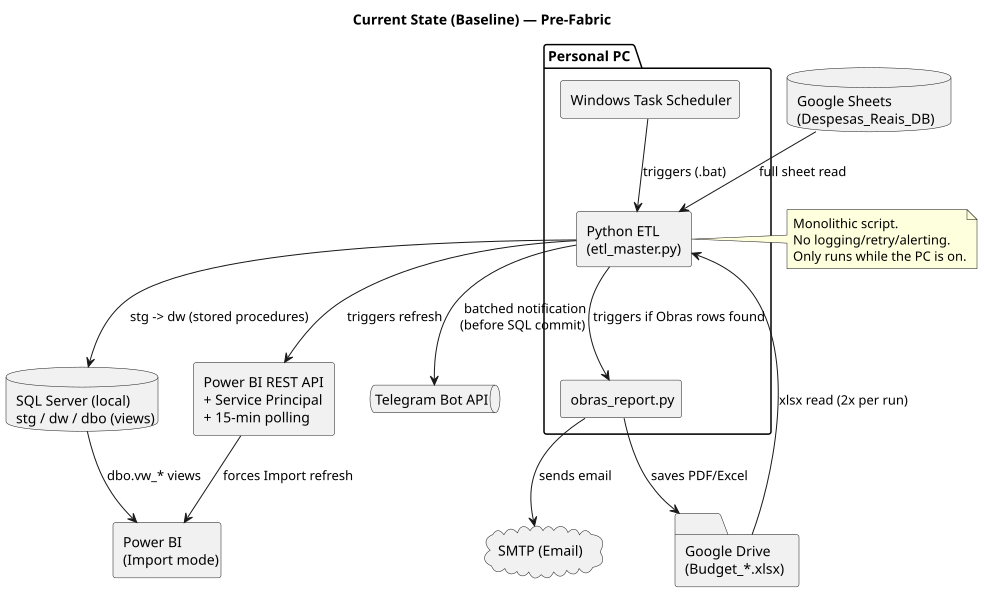
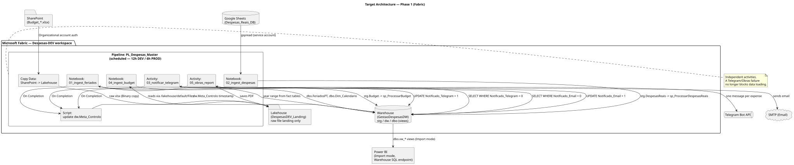

# Family Expense Management — Migration to Microsoft Fabric

**Status:** Phase 0 (Baseline) complete. Phase 1 not yet started.  
**Last updated:** 2026-10-20

## 1. Purpose

This document describes the migration plan of a personal family expense management solution from a PC-dependent architecture (Google Forms → Excel → Python ETL → local SQL Server → Power BI) to Microsoft Fabric.

The project has two goals of equal importance:

1. **Functional**: remove the dependency on a personal PC to run scheduled ETL jobs, and modernize the data platform.
2. **Learning**: use this project as a structured, hands-on way to learn Microsoft Fabric, to be documented and eventually shared as a technical proof-of-concept (POC).

The migration will be executed in three phases:

- **Phase 0 — Baseline** (current state): commit the legacy local codebase to Git to establish a secure starting point.
- **Phase 1 — Foundation** (planned): replicate the current logic on Fabric infrastructure, changing *where* things run, not *how* they work.
- **Phase 2 — Modernization** (tentative): candidate directions include PySpark notebooks, a Lakehouse/medallion structure, and event-driven notifications.
- **Phase 3 — Showcase**: package the project as a public POC/demo.

This document currently documents the **Phase 0 baseline** in detail and outlines the proposed target architecture for **Phase 1**.

## 2. Current State Architecture (Baseline)

### 2.1 Components

| Component | Technology | Notes |
|---|---|---|
| Expense capture | Google Forms → Google Sheets | Single sheet, no incremental read (full sheet read every run) |
| Budget input | Excel files on Google Drive (`Budget_YYYY.xlsx`) | Read twice per run (values + a separate "targets" sheet) |
| Orchestration | Windows Task Scheduler → `.bat` → Python | Runs only when the PC is powered on |
| ETL | Python (`etl_master.py`, `obras_report.py`) | Extraction, transformation, load, notifications — all in one monolithic script |
| Staging | SQL Server, schema `stg` | Untyped (mostly `nvarchar`), truncated after each load |
| Data warehouse | SQL Server, schema `dw` | Dimensional model: `Dim_Categoria`, `Dim_Calendario`, `Dim_MetasMensais`, `Fact_DespesasReais`, `Fact_Obras`, `Fact_Receitas`, `Fact_Saldos`, `Fact_Budget` |
| Reporting views | SQL Server, schema `dbo` (`vw_*`) | Stable contract layer consumed by Power BI |
| Deduplication | Business key `Carimbo_Original` (form response timestamp), enforced with `NOT EXISTS` in stored procedures | Effective and idempotent |
| Notifications — Telegram | Bot API, batched in chunks of 20 expenses per message | Sent **before** SQL commit is confirmed |
| Notifications — Obras (renovation) email | SMTP, triggered after SQL load if new "Obras" rows detected | Generates PDF + Excel, saves to Google Drive, sends email |
| BI refresh | Power BI REST API, Service Principal (MSAL), polling loop up to 15 minutes | Only needed because the semantic model is **Import mode** |

## 3. Migration Objectives

- Eliminate dependency on a personal PC for scheduled ETL execution.
- Progressively replace the local SQL Server with appropriate Fabric components.
- Continue serving Power BI reliably.
- Learn and apply Microsoft Fabric best practices through this project.
- Establish DEV and PROD environments.
- Implement version control via GitHub.

## 4. Target architecture diagram

## 5. Environment Strategy (Planned)

To validate the new pipeline without affecting the existing production report, a parallel environment will run initially:

| Component | DEV/UAT | PROD (current) |
|---|---|---|
| Workspace | `Despesas-DEV` (Fabric) | Local SQL Server |
| Telegram | New bot + private chat (owner only) | Existing bot/chat |
| Power BI | Duplicated `.pbip`, published to a test workspace | Existing report, untouched |

Once confidence is established and data matches, the local SQL Server will be decommissioned.

## 6. Implementation Plan — Phase 1

The following steps are planned for execution:

- **Step 1:** Activate Fabric trial and create workspace.
- **Step 2:** Create Fabric Warehouse and recreate schemas/tables.
- **Step 3:** Port T-SQL stored procedures (adapting syntax where Fabric differs from SQL Server).
- **Step 4:** Build ingestion notebooks (Budget, Expenses) and notification logic.
- **Step 5:** Build the orchestrating Fabric Pipeline.
- **Step 6:** Reconnect the Power BI semantic model to Fabric.
- **Step 7:** Run parallel validation, then cut-over.

## 7. Repository Structure

- `docs/` — Architecture documentation and design decisions.
- `notebooks/` — Fabric notebooks and legacy Python scripts.
- `pipelines/` — Fabric pipeline definitions.
- `powerbi/` — Power BI reports and project files.
- `tests/` — SQL scripts for data validation.
- `warehouse/` — SQL schemas, tables, views, and stored procedures.